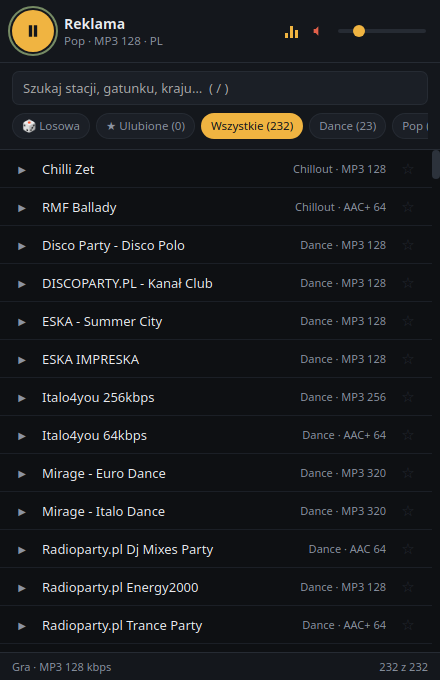

# Antena — lekkie radio internetowe (Tauri + HTML/CSS/JS)



Radio internetowe na Linuksa, Windows i Androida: 252 gotowe stacje, wyszukiwanie,
gatunki, ulubione, tytuł aktualnie grającego utworu. Interfejs to czysty HTML/CSS/JS
(bez frameworków, bez bundlera, bez `node_modules`), a warstwa natywna w Rust zajmuje
się tylko oknem i odczytem metadanych ICY.

## Funkcje

- **252 stacje** — 78 polskich (RMF i wszystkie jego kanały, Zet, Chilli Zet, Eska,
  Antyradio, Radio 357, Radio Nowy Świat, Radio Kampus, TOK FM, Wnet, Polskie Radio,
  stacje lokalne) plus zagraniczne, m.in. Radio Paradise, FIP, Deutschlandfunk,
  NTS, Radio Swiss Pop, Venice Classic i osiem kanałów SomaFM.
- 30 gatunków do filtrowania (jazz, klasyczna, elektronika, ambient, chillout, rock,
  metal, reggae, blues, ludowa, Latino, wiadomości, lata 70/80/90 i inne).
- Wyszukiwanie po nazwie / gatunku / kraju oraz filtry gatunków (chipy).
- Ulubione (gwiazdka lub klawisz `f`), zapamiętywane lokalnie.
- **Tytuł grającego utworu** (metadane ICY/Icecast) — wyświetlany w pasku u góry.
- Klawisze multimediów przez Media Session API (jeśli Twoje WebKitGTK eksponuje MPRIS,
  stacja pojawi się też w panelu systemowym).
- Zapamiętywanie głośności, wyciszenia i ostatniej stacji.
- Ciemny, kompaktowy interfejs; okno 440×680 px.


## Wymagania

- Linux z GTK3 i WebKitGTK 4.1 (`webkit2gtk-4.1`)
- GStreamer z kodekami: `gst-plugins-base`, `gst-plugins-good`, `gst-plugins-ugly` (mp3/mpg123),
  `gst-plugins-bad` (aac/faad), `gst-libav` — bez nich dźwięk nie zagra.
- Rust (1.77+)
- Opcjonalnie `tauri-cli` — tylko do budowania paczek `.deb`/AppImage

Debian/Ubuntu/Mint:

```bash
sudo apt install libwebkit2gtk-4.1-dev libgtk-3-dev \
  gstreamer1.0-plugins-base gstreamer1.0-plugins-good \
  gstreamer1.0-plugins-ugly gstreamer1.0-plugins-bad gstreamer1.0-libav
```

Arch: `sudo pacman -S webkit2gtk-4.1 gtk3 gst-plugins-base gst-plugins-good gst-plugins-ugly gst-plugins-bad gst-libav`
Fedora: `sudo dnf install webkit2gtk4.1-devel gtk3-devel gstreamer1-plugins-{base,good,bad-free,ugly-free} gstreamer1-libav`

Metadane ICY idą przez `rustls`, więc systemowe OpenSSL (`libssl-dev`) nie jest potrzebne.

## Uruchomienie

```bash
./run.sh            # tryb deweloperski (cargo run)
./build.sh          # binarka release: src-tauri/target/release/antena
./build.sh bundle   # paczki .deb / AppImage (pobierze tauri-cli, jeśli brak)
```

Po zmianach w `ui/` wystarczy ponownie uruchomić `./run.sh` — pliki interfejsu są
wkompilowane w binarkę (nie ma serwera deweloperskiego ani modułów Node).

## Windows (i macOS)

Cele bundli są ustawione w `tauri.conf.json` (`bundle.targets`), więc samo
`tauri build` tworzy na każdym systemie to, co trzeba: Linux → `deb` + AppImage,
Windows → instalator `.exe` (NSIS), macOS → `.dmg`.

Windowsa można zbudować cross-toolchainem z Linuksa (`cargo-xwin` + LLVM +
NSIS), ale prościej i bez lokalnych zależności zrobi to GitHub Actions:
workflow `.github/workflows/build.yml` buduje `deb` + AppImage na Linuksie,
`.exe` na Windowsie oraz APK na Androida. Uruchomienie: zakładka
**Actions → build → Run workflow**. Pliki pojawiają się w sekcji **Artifacts**,
a po udanym buildzie workflow tworzy dodatkowo **Release** i dołącza do niego
pliki (sekcja **Assets**); tag release bierze się z wersji w `tauri.conf.json`
(np. `v1.0.0`), a przy wypchnięciu tagu (`git tag v1.0.0 && git push --tags`) —
z tego tagu. Pole `release_tag` pozwala nadpisać tag przy ręcznym uruchomieniu
(np. `1.0.0`, żeby dołączyć APK do istniejącego wydania).

macOS trzeba zbudować na macOS (Apple nie udostępnia swojego toolchainu na
Linuksa); wystarczy dopisać jedną pozycję do macierzy w workflow — komentarz w
pliku pokazuje jak.

## Android (APK)

Job `Android (APK)` w workflow buduje uniwersalny APK (`arm64-v8a` +
`armeabi-v7a`, Android 7.0+, `minSdk 24`) i dołącza go do Release jako
`antena-<wersja>-android.apk`. Plik jest też dostępny w **Artifacts** danego
uruchomienia.

Instalacja: zezwól na instalowanie z nieznanych źródeł i stuknij plik albo użyj
`adb install antena-1.0.0-android.apk`.

Build lokalny (wymaga JDK 17+, Android SDK i NDK):

```bash
npx @tauri-apps/cli@^2 android init --ci --skip-targets-install
python3 scripts/android-patch.py
npx @tauri-apps/cli@^2 android build --apk --target aarch64 armv7
```

Kilka uwag:

- **HTTP** — 152 z 252 stacji nadaje po `http://`. `scripts/android-patch.py`
  włącza `usesCleartextTraffic` w wersji release, bo inaczej Android by je zablokował.
- **Podpis** — APK jest podpisywany kluczem debug (zero konfiguracji, wygodne do
  sideloadu). Kolejny build ma inny klucz, więc aktualizacja „na wierzch” wymaga
  odinstalowania starej wersji. Do sklepu Play trzeba własnego keystore
  (`src-tauri/gen/android/keystore.properties` — szczegóły w dokumentacji Tauri).
- **Tło** — po zminimalizowaniu aplikacji system może wstrzymać dźwięk; nie ma
  foreground service, więc nie ma pewności, że radio gra dalej przy zgaszonym ekranie.
- Projekt Android (`src-tauri/gen/android/`) generuje `tauri android init` i nie
  jest wersjonowany.

## Skróty klawiszowe

| Klawisz | Działanie |
| --- | --- |
| `Spacja` | odtwórz / zatrzymaj |
| `↑` / `↓` | poprzednia / następna stacja (z uwzględnieniem filtrów) |
| `/` | przejdź do wyszukiwania |
| `f` | dodaj/usuń bieżącą stację z ulubionych |
| `m` | wycisz |
| `Esc` | wyczyść wyszukiwanie |

## Dodawanie własnych stacji

Otwórz `ui/stations.js` i dopisz wpis na końcu tablicy:

```js
{ n: "Nazwa stacji", u: "https://adres/strumienia.mp3", g: "Rock", k: "MP3", b: 128, c: "PL" },
```

- `n` — nazwa, `u` — adres strumienia (mp3/aac/ogg/opus), `g` — gatunek (nowy gatunek
  automatycznie pojawi się jako chip), `k` — kodek, `b` — bitrate, `c` — kraj (może być pominięte).

Lista została wygenerowana z Radio-Browser i przetestowana pod kątem działania.
Strumienie internetowe z czasem padają — jeśli jakaś stacja nie gra, aplikacja
oznaczy jej nazwę na czerwono i pokaże komunikat w pasku dolnym.

## Dlaczego to jest oszczędne

- Zero frameworków i zero zależności JS — łącznie ~34 KB plików (z tego 30 KB to baza stacji).
- Lista stacji budowana **raz**; filtrowanie to tylko przełączanie klasy CSS, bez
  ponownego renderowania DOM.
- `content-visibility: auto` — WebKit nie renderuje wierszy poza ekranem.
- Jeden element `<audio>` na całe radio (`preload="none"`: nic nie łączy się przed kliknięciem).
- Metadane ICY pobierane wyłącznie w czasie grania, jedno krótkie zapytanie TCP co 15 s.
  Brak wątków w tle, brak pollowania w JS.
- **Brak animacji w interfejsie** — wskaźnik „gra” jest statyczny. To nie przypadek:
  animowany korektor wymuszał w WebKitGTK ciągłe odświeżanie okna i zjadał
  kilkanaście–kilkadziesiąt procent rdzenia. Pomiar na tej samej maszynie
  (XFCE, X11, WebKitGTK 2.52); jeden rdzeń = 100%:

  | Stan | CPU (suma procesów) | RAM (RSS) |
  | --- | --- | --- |
  | Zatrzymane / bezczynne | ~0% | — |
  | Gra stacja MP3 128 kbps, animowany wskaźnik | 13–45% | — |
  | Gra stacja MP3 128 kbps, wskaźnik statyczny | **~4%** | 134 + 229 + 65 MB |

  Zużycie pamięci to niemal wyłącznie współdzielone biblioteki WebKitGTK (proces
  główny ~134 MB, proces strony ~229 MB, sieciowy ~65 MB) — Tauri na Linuksie nie ma
  lżejszej alternatywy, bo korzysta z systemowej przeglądarki. Binarka aplikacji ma 4 MB.
- Profil release: `opt-level = "z"`, LTO, `strip`, `panic = "abort"` — mała i szybka binarka.
- Metadane ICY korzystają z `rustls` (czysty Rust), więc nie ma zależności od
  systemowego OpenSSL — również na Androidzie.
- Uprawnienia Tauri ograniczone do `core:default`; CSP blokuje wszystko poza własnymi
  plikami i strumieniami audio.


## Znane ograniczenia

- Odtwarzanie robi WebKitGTK przez GStreamer, więc **strumienie HLS (`.m3u8`) nie działają**
  — dlatego nie ma np. Polskiego Radia Trójki (nadaje tylko w HLS). Wybierane są strumienie
  progresywne: MP3, AAC/AAC+, OGG/Opus.
- Adresy strumieni zmieniają się z czasem. Martwa stacja jest widoczna od razu:
  nazwa zmienia kolor na czerwony, a w pasku dolnym pojawia się komunikat błędu.
- Zużycie pamięci (~0,4 GB RSS) wynika z WebKitGTK — każda aplikacja Tauri na Linuksie
  korzysta z systemowej przeglądarki i dzieli z nią biblioteki.
- Na Androidzie po zminimalizowaniu aplikacji system może wstrzymać dźwięk (brak
  foreground service), więc radio może przestać grać przy zgaszonym ekranie.

## Struktura projektu

```
antena/
├── build.sh, run.sh        # skrypty pomocnicze
├── scripts/
│   └── android-patch.py    # HTTP + podpis debug w generowanym projekcie Android
├── .github/workflows/      # build.yml: Linux (deb/AppImage) + Windows (.exe) + Android (APK)
├── doc/zrzut-ekranu.png    # zrzut ekranu
├── ui/                     # frontend: czysty HTML/CSS/JS
│   ├── index.html
│   ├── style.css
│   ├── app.js              # logika radia (~330 linii)
│   └── stations.js         # baza stacji
└── src-tauri/              # warstwa natywna (Rust)
    ├── Cargo.toml
    ├── tauri.conf.json     # okno, CSP, uprawnienia, paczki
    ├── capabilities/default.json
    └── src/
        ├── main.rs         # binarka desktopowa
        ├── lib.rs          # punkt wejścia (desktop + mobile) i komenda `now_playing`
        └── icy.rs          # odczyt metadanych ICY (HTTP/HTTPS, własny, lekki klient)
```

Projekt Android (`src-tauri/gen/android/`) jest generowany przez `tauri android init`
(przez CI lub lokalnie) i nie jest wersjonowany.

Testy parsera metadanych: `cargo test --manifest-path src-tauri/Cargo.toml`
